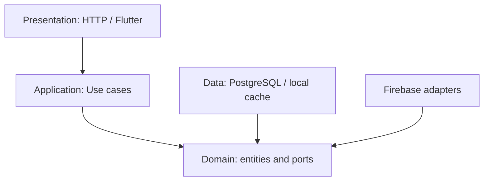
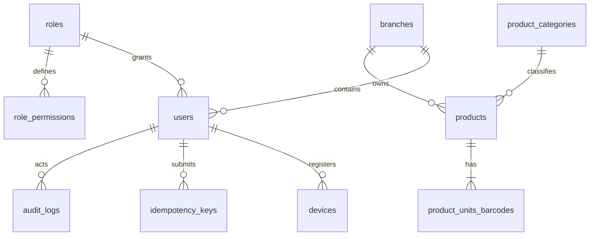
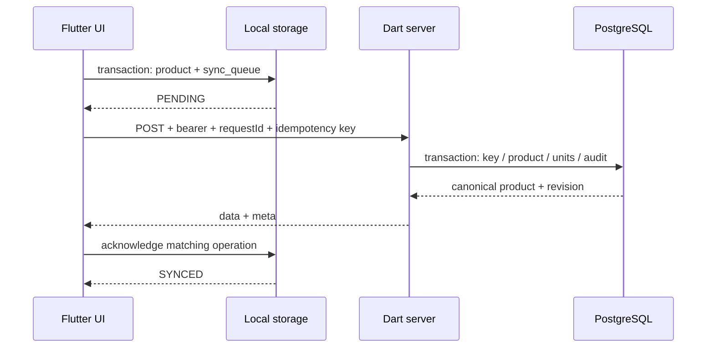
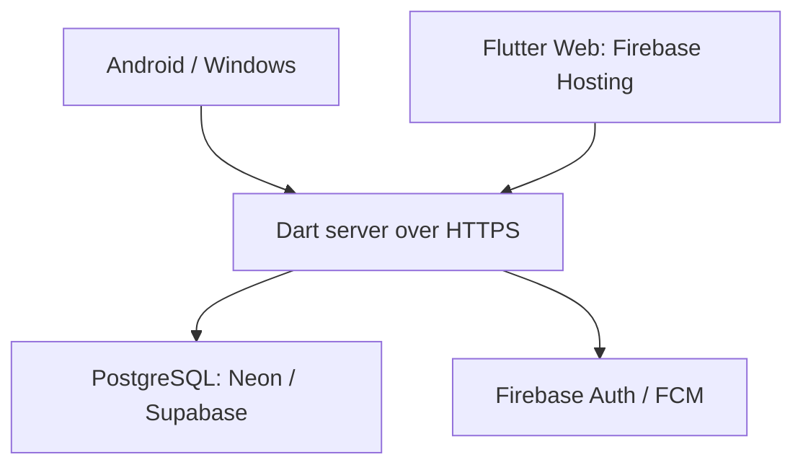

# الدورة الأولى: المعمارية وعقود التشغيل

> الحالة: أقسام Flutter والمزامنة المحلية وPDF أدناه تصف التصميم المستهدف؛ تنفيذها هو الدفعة التالية. الخادم والعقود وحدهما مكتملان ضمن نطاق الدفعة الحالية.

## النطاق

هذه الوثيقة تخص تأسيس الكتالوج والمصادقة والمزامنة وتقارير الأصناف فقط. حالة كل دورة في `IMPLEMENTATION_STATUS.md`؛ لا تعني مهمة GitHub أن تنفيذها مكتمل. PostgreSQL مصدر الحقيقة؛ التخزين المحلي نسخة عمل وطابور أوامر يعاد إرساله بمفتاح ثابت. لا توجد بيانات أصناف أو أطراف تجريبية في تثبيت الإنتاج.

## ADR-001: الطبقات والاعتماد على الواجهات

تعتمد حالات الاستخدام على واجهات المستودعات والتحقق والإشعارات. التجميع في نقطة التشغيل وحدها يختار PostgreSQL أو الذاكرة. لا تستورد طبقة المجال Shelf أو PostgreSQL أو Flutter. العقود مشتركة، والمال يُرسل نصاً عشرياً ثابتاً إلى منزلتين لتجنب أخطاء التقريب الثنائي. معامل التحويل كمية عشرية موجبة، والمخزون لا يُحرر من شاشة الأصناف. إنشاء الصنف يبدأ برصيد صفر؛ تعديل تعريفه يحافظ على الرصيد.

## قاعدة البيانات

مفاتيح UUID، وحقول الوقت UTC، وحذف منطقي. الباركود وكود الصنف وPLU فريدة داخل الفرع النشط. كل مستخدم مرتبط مسبقاً بفرع ودور؛ تسجيل Firebase وحده لا يمنح صلاحية إنشاء مدير أو فرع. يهيئ المسؤول الفرع وأول مستخدم بالأداة الموثقة في README، ثم يصادق العميل. لا يُقبل branchId من العميل لتجاوز فرع الجلسة.

## دورة الزر والعمل دون اتصال

يحفظ التطبيق الصنف وأمر المزامنة في معاملة محلية واحدة. لكل تعديل UUID مستقل ثابت لا يتغير عند retry. تعرض الواجهة PENDING أو SYNCED أو CONFLICT؛ لا تُبتلع أخطاء 409. لا يعاد تطبيق نسخة قديمة على تعديل أحدث في الجهاز. يجري سحب الصفحات حتى nextCursor=null، ويُحفظ ETag لكل صفحة. البحث المحلي لا ينتظر الشبكة؛ زمنه يُقاس ولا يُضمن على كل جهاز.

## المصادقة وعقد HTTP

`AuthVerifier` يتحقق من RS256 باستخدام مفاتيح Google JWK المخزنة مؤقتاً، وkid وaud وiss وsub وexp وiat وauth_time. لا يقبل توكن محلياً أو مجهول التوقيع. `FirebaseAuthAdapter` في العميل يستخدم Firebase REST حتى تعمل واجهة الدخول أيضاً على Windows. تجديد التوكن يتم عبر Secure Token API؛ لا تسجل كلمات السر أو التوكنات. على الأجهزة يخزن refresh token في مخزن النظام الآمن، وفي الويب يبقى في الذاكرة. تُحفظ بيانات الجلسة غير السرية للاستمرار محلياً بعد انقطاع الاتصال؛ لا تمنح الجلسة المحلية وصولاً إلى الخادم دون توكن صالح.

كل طلب مؤمّن له `X-Request-Id` وBearer. POST له `Idempotency-Key` UUID. الرد الناجح `data/meta` والخطأ `error.code/message/requestId`. يعيد تكرار نفس المفتاح ونفس المحتوى النتيجة السابقة؛ تغيير المحتوى مع المفتاح نفسه يعيد409. يعزل المفتاح حسب المستخدم والفرع والمسار، ويحتفظ به الخادم بلا انتهاء تلقائي في هذه المرحلة حتى لا يعاد إنشاء طلب offline قديم. التعديل يتطلب revision مطابقاً ويعيد409 عند التعارض. CORS يسمح فقط بالأصول المضبوطة ويكشف ETag وX-Request-Id. حد الصفحة30؛ cursor opaque صالح للفرع ويعتمد الترتيب بكود UUID الثابت. تحديثات أثناء التصفح تُلتقط عند refresh جديد.

## النشر والحدود

Hosting يقدم الملفات الساكنة فقط؛ خادم Dart يحتاج استضافة مستقلة. الخطط المجانية متغيرة ولها حدود تخزين ونقل واتصالات وسكون؛ تُراجع قبل النشر ولا تُعد ضمان تكلفة صفر أو SLA. لا تُنشأ مشاريع Firebase أو PostgreSQL ولا أسرار إنتاج تلقائياً. يُستخدم HTTPS وDATABASE_URL وFIREBASE_PROJECT_ID وCORS_ORIGINS في البيئة. وضع الذاكرة صريح للتطوير فقط، ويُمنع تشغيله مع APP_ENV=production. الاستضافة والأداء الحقيقي وبناء Android/Windows بحاجة إلى الأدلة المحددة بسجل التنفيذ.

## التقرير الرسمي

`OfficialReportTemplate` نسخة حرفية من المرجع المرفق. ملفات الخطوط محلية، والشعار PNG شفاف صالح. الطباعة تستدعي preview مع printAfterGenerate=true؛ الحفظ يولد bytes دون طباعة ويمررها لاختيار الوجهة. إلغاء المستخدم لا يكتب ملفاً آخر. اختبارات padding/truncation للصفوف تتم عبر المدخل العام وتفحص بنية PDF دون كشف دالة private أو تغيير المرجع.

## المراجع الرسمية

- [Firebase ID token verification](https://firebase.google.com/docs/auth/admin/verify-id-tokens)
- [Firebase Auth REST](https://firebase.google.com/docs/reference/rest/auth)
- [Flutter adaptive design](https://docs.flutter.dev/ui/adaptive-responsive/general)
- [PostgreSQL Dart driver](https://pub.dev/packages/postgres)
- [Firebase Hosting quotas](https://firebase.google.com/docs/hosting/usage-quotas-pricing)

## الفجوات المسجلة للمهام اللاحقة

الدورة3 مكررة وتنفذ مرة واحدة. الدورة4 غير مرفقة فلا يُدعى إنجازها. قائمة migration003 تسمي19جدولاً رغم قول14؛ تُعتمد الأسماء. صيغة باركود الميزان في الدورة2 وعدد الخانات والمثال تحتاج قرار layout/checksum موثقاً قبل بناء parser. التراخيص لا تستطيع تقديم بصمة غير قابلة للتزوير، وسر HMAC داخل عميل قابل للاستخراج؛ يُفصل توقيع الخادم عن التحقق العام قبل الدورة7.
